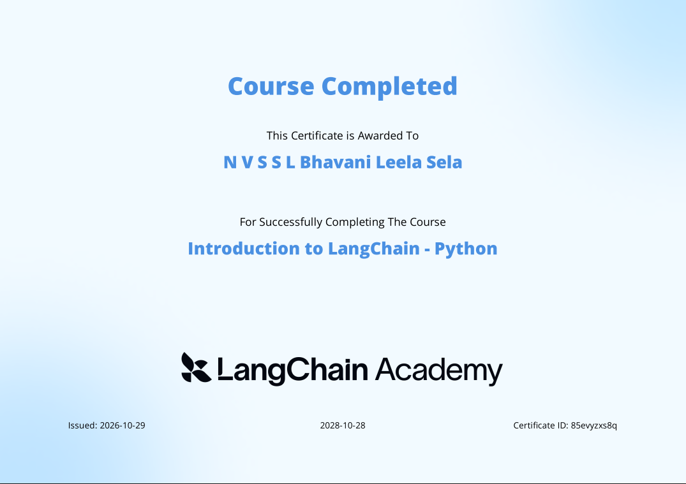

# LangChain Academy – Introduction to LangChain

## By **LangChain**

## Offered through [**LangChain Academy**](https://academy.langchain.com/)


## My Course Certificate

<p align="center">
  
</p>

[View My Certificate](https://academy.langchain.com/certificates/85evyzxs8q)

---

## WHAT YOU WILL LEARN

- Understand the fundamentals of Large Language Models (LLMs) and build applications using LangChain.
- Work with chat models, prompts, message types, and structured outputs.
- Integrate tools and enable LLMs to interact with external systems and APIs.
- Understand conversation history, memory, and runtime context.
- Build intelligent applications using LangChain's agent architecture.
- Explore agent state, middleware, dynamic model selection, and multi-agent workflows.
- Understand Model Context Protocol (MCP) and its role in connecting AI applications with external tools.
- Explore Retrieval-Augmented Generation (RAG) and SQL-based interactions.
- Implement human-in-the-loop workflows and understand how to control agent execution.

---

## About This Course

The **Introduction to LangChain** course by LangChain Academy provides a practical introduction to building applications powered by Large Language Models using the LangChain ecosystem.

The course focuses on understanding how LLM applications work and how to connect language models with prompts, tools, memory, external data sources, and other components to develop intelligent applications.

Through hands-on exercises and practical implementations, I explored the fundamentals of LangChain and its application-building capabilities, progressing towards more advanced concepts such as agents, middleware, runtime context, and multi-agent systems.

This learning experience helped me understand how to move beyond basic LLM interactions and develop more structured, context-aware, and tool-enabled AI applications.

---

## My Learning Journey

Throughout this course, I explored the following concepts and practical implementations.

### MODULE 1 – LLM Fundamentals and LangChain Basics

- Introduction to foundational language models.
- Working with chat models and model providers.
- Prompt templates and message handling.
- Structured outputs and model responses.
- Building practical LLM-powered applications.
- Exploring tool integration and model interactions.

### MODULE 2 – Agents, Tools and Runtime Context

- Understanding tools and tool calling.
- Connecting LLMs with external tools and APIs.
- Working with agent state and runtime context.
- Managing conversation history and memory.
- Understanding multimodal messages.
- Exploring Model Context Protocol (MCP).
- Building context-aware agent workflows.

### MODULE 3 – Advanced Agent Development

- Understanding agent architecture and execution.
- Working with middleware.
- Dynamic model selection.
- Managing agent state and runtime configuration.
- Human-in-the-loop workflows.
- Exploring multi-agent systems.
- Understanding advanced agent customization.

### BONUS LEARNING

- Retrieval-Augmented Generation (RAG).
- SQL-based interactions and database querying.
- Exploring practical applications of LLM-powered retrieval and data access.

---

## Practical Exercises and Implementations

This repository contains my hands-on learning exercises, notebooks, and Python implementations from the LangChain Academy course.

Some of the areas explored include:

- Foundational model experimentation.
- Personal Chef application.
- Runtime context implementation.
- Dynamic model selection.
- Tool-enabled LLM workflows.
- Agent and middleware experimentation.
- RAG and SQL learning exercises.

Each notebook and implementation represents part of my journey in understanding how to build practical LLM-powered applications.

---

## Technologies and Tools

| Category | Technologies |
|---|---|
| Programming Language | Python |
| LLM Framework | LangChain |
| Agent Framework | LangGraph |
| Model Providers | Groq, Anthropic and other supported providers |
| AI Concepts | LLMs, Agents, RAG, MCP |
| Data & Retrieval | SQL, Embeddings, Vector Search |
| Development Tools | VS Code, Jupyter Notebook |
| Environment Management | uv, Python Virtual Environments |
| Version Control | Git and GitHub |

---

## Repository Structure

```text
langchain-academy-learning/
│
├── notebooks/
│   ├── module-1/
│   │   ├── 1.1_foundational_models.ipynb
│   │   └── 1.5_personal_chef.py
│   │
│   ├── module-2/
│   │   └── 2.2_runtime_context.ipynb
│   │
│   └── module-3/
│       └── 3.4_dynamic_models.ipynb
│
├── bonus_rag.ipynb
├── bonus_sql.ipynb
├── pyproject.toml
├── uv.lock
├── .gitignore
└── README.md
```

*Note: The structure above highlights selected learning files. The repository may contain additional course files and exercises.*

---

## Key Takeaways

Through this course, I strengthened my understanding of:

- How LLMs work within application architectures.
- How to build applications using LangChain.
- How agents reason and interact with tools.
- How to manage context, state, and conversation history.
- How middleware can customize agent behaviour.
- How RAG can connect LLMs with external knowledge.
- How to design more flexible and context-aware AI workflows.

Most importantly, this course helped me strengthen the practical foundation required to explore **Generative AI, Agentic AI, and advanced AI application development**.

---

## Course Information

- **Course:** Introduction to LangChain
- **Platform:** LangChain Academy
- **Course Provider:** LangChain
- **Programming Language:** Python
- **Learning Format:** Online learning and hands-on exercises
- **Certificate:** Completed

Course link: [LangChain Academy](https://academy.langchain.com/)

---

## My Certificate Details

- **Certificate:** LangChain Academy – Introduction to LangChain
- **Certificate ID:** `85evyzxs8q`
- **Issued:** October 2026
- **Valid Until:** October 28, 2028

[View Course Platform](https://academy.langchain.com/)

---

## Author

**Bhavani Leela**

- GitHub: [@BhavaniLeela](https://github.com/BhavaniLeela)
- LinkedIn: [My LinkedIn Profile](https://www.linkedin.com/in/bhavanisela/)

---

⭐ This repository documents my continuous learning journey in LangChain, Generative AI, and Agentic AI through practical exercises and implementations.
